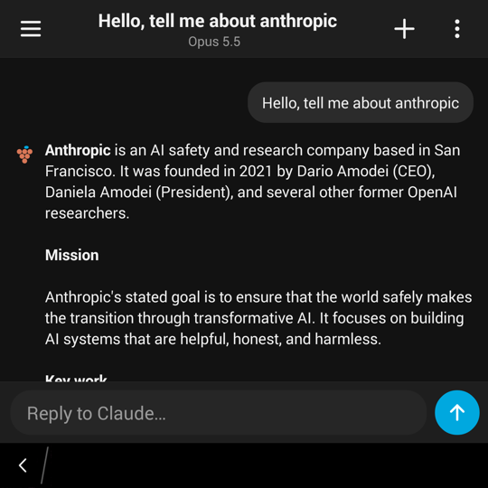
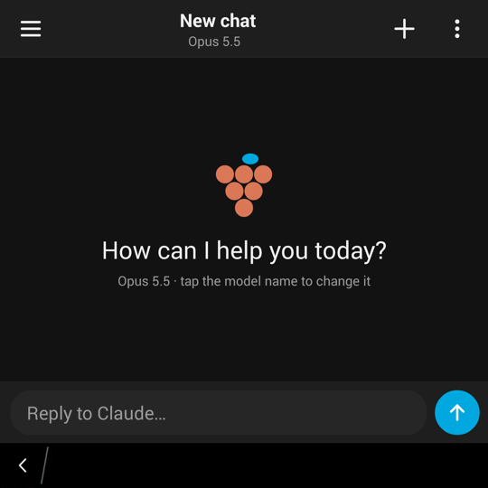
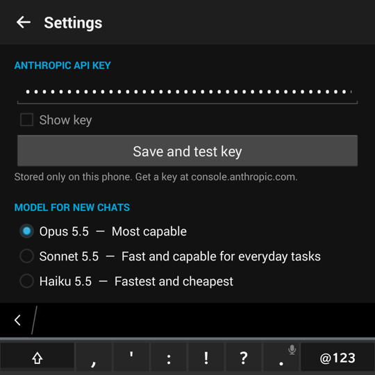
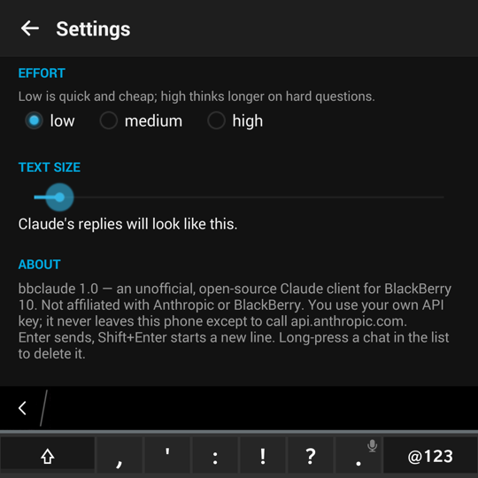

<p align="center"></p>

# bbclaude

An unofficial, open-source Claude client for **BlackBerry 10**, built and tested
on a BlackBerry Passport (OS 10.3.3). It comes in two flavours:

| | `android/` — the app | `cli/` — the terminal client |
|---|---|---|
| Runs in | BB10's built-in Android runtime | [Term49](https://github.com/BerryFarm/Term49/releases) |
| Install | tap the `.apk` | build on the phone with GCC |
| Language | Java, no Gradle, no dependencies but Conscrypt | C99 + libcurl |

> bbclaude is a hobby project. It is not made, endorsed or supported by
> Anthropic or BlackBerry. You bring your own
> [Anthropic API key](https://console.anthropic.com/settings/keys) and pay for
> your own usage.

## The app

<p align="center">
  
  
  
  
</p>
<p align="center"><sub>Screenshots from a BlackBerry Passport (1440×1440).</sub></p>

A dark, BB10-styled chat app modelled on the Claude mobile app:

- Streaming replies with Markdown (headings, lists, code, bold, links)
- Saved chats: list, resume, long-press to delete
- Claude Opus 5.5, Sonnet 5.5 and Haiku 5.5, with low / medium / high effort
- Adjustable text size, keyboard-first: **Enter** sends, **Shift+Enter** adds a line
- Stop button while a reply streams
- The API key is stored only in the app's private storage and only sent to
  `api.anthropic.com`

### Install

1. Download `bbclaude.apk` from the [releases](../../releases) page onto the phone
   (browser, USB or email).
2. Tap it in File Manager and allow the install. No BlackBerry signing,
   developer mode or debug token is needed.
3. Open **bbclaude** → ⋮ → paste your API key → **Save and test key**.

### Build

Needs a JDK 17 and the Android SDK (`platforms;android-18`,
`build-tools;34.0.0`). No Gradle.

```sh
cd android
ANDROID_HOME=~/Library/Android/sdk ./build.sh       # debug-signed bbclaude.apk
KEYSTORE=~/keys/bbclaude.jks KS_PASS=... ./build.sh # release-signed
```

`tools/make_icon.py` redraws the launcher icon (pure Python, no libraries):
`python3 android/tools/make_icon.py android/res`.

### Why it is built this way

- **TLS.** BB10's Android runtime is Android 4.3, whose system TLS cannot
  connect to `api.anthropic.com`. The app bundles
  [Conscrypt](https://github.com/google/conscrypt) 2.5.3 (BoringSSL, ARMv7) and
  routes every request through it.
- **No native Cascades app.** BlackBerry's signing servers are gone, and
  unsigned `.bar` files only install with a debug token, which can no longer be
  issued. Android APKs install with an ordinary self-signed certificate.
- **Android 4.3 quirk.** A `401` without an auth challenge header throws
  `IOException: No authentication challenges found`; the client maps it back to
  401 ("check your API key").
- **API details.** Messages API with streaming (SSE), thinking blocks echoed
  back unchanged, server-side fallbacks on models that support them, and failed
  or declined turns removed so the history stays valid.

## The terminal client

See [`cli/README.md`](cli/README.md). Short version: install Term49 and
Berrymuch, copy `cli/` to the phone, `make CC=gcc`, run `./bbclaude`.

## Contributing

Issues and pull requests are welcome, especially from anyone with other BB10
devices (Classic, Z10, Q10, Z30, Leap) who can confirm it works there.

## License

[Apache License 2.0](LICENSE). See [NOTICE](NOTICE) for the bundled Conscrypt
library and the trademarks.
